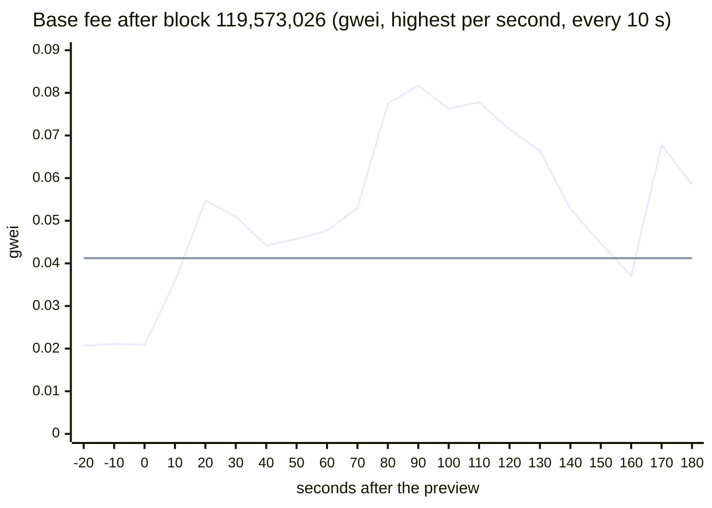

# Is a 2× fee cap enough for a 60-second transfer preview on Robinhood Chain?

*November 2026 · measured 20–21 Nov 2026 on the official Robinhood Chain RPC · harnesses and raw data in
[syncronix-benchmarks](https://github.com/SyncronixLabs/syncronix-benchmarks#fee-headroom)*

## Question

SYNCRONIX [wallet-approved transfers](https://github.com/SyncronixLabs/syncronix-docs/blob/main/wallet-transfers.md)
show a preview that is valid for 60 seconds. When you confirm, the page hands your wallet a type-2 (EIP-1559)
transaction with these settings:

| Setting | Value |
|---|---|
| Gas limit | `eth_estimateGas` + 20 % |
| Fee cap (`maxFeePerGas`) | 2 × `eth_gasPrice` at preview time |
| Priority tip | 0 |

You pay the block's base fee, not the cap. The cap only bounds the worst case shown in the preview ("at most …").
But a transaction whose cap is below the current base fee cannot go into a block. The official RPC says so directly
(read-only call, nothing sent):

```
eth_estimateGas {…, "maxFeePerGas": "0x1"} → max fee per gas less than block base fee: … maxFeePerGas: 1, baseFee: 20274000
```

So we asked: how often does the base fee rise above 2× its value within the 60 seconds a preview is valid? And does
the +20 % gas headroom ever matter?

## Method

Three read-only harnesses. They use no SYNCRONIX endpoint, no wallet and no key; estimates use two well-known
placeholder addresses with value 0.

1. **History** (`fee-headroom.mjs`): 288 windows spread evenly over the last 24 hours on mainnet (20 Nov 12:15 to
   21 Nov 12:05 UTC) and on testnet. Each window reads the block at its start and one block every 10 s up to 60 s
   later. A 10 s sample can miss a short peak, so these ratios are lower bounds.
2. **Live** (`fee-headroom.mjs`): 30 minutes on mainnet and 15 minutes on testnet (21 Nov, from 12:13 UTC). Every
   10 s it read:
   - the base fee of every block, via `eth_feeHistory`;
   - `eth_gasPrice`;
   - `eth_estimateGas` for a plain transfer;
   - the L1 data component from the chain's NodeInterface (`gasEstimateL1Component`; Robinhood Chain is built on
     Arbitrum).
3. **Spikes** (`fee-spike.mjs`): the base fee of every block from 30 s before to 180 s after the two largest windows
   that the history found.

Blocks: mainnet produced about 9.5 blocks per second and testnet about 4.8 in this period.

## Results

### Base fee within a 60 s window

| | Mainnet, 24 h history | Mainnet, 30 min live | Testnet, 24 h + 15 min |
|---|---|---|---|
| Windows | 288 (sampled every 10 s) | 1,581 (every block, 16,379 blocks) | 288 + 1,003 |
| Base fee | 0.020–0.045 gwei (median 0.0203) | 0.020–0.029 gwei | 0.01 gwei, constant |
| Highest base fee in window ÷ base fee at start, median | 1.008 | 1.025 | 1.000 |
| … 99th percentile | 1.62 | 1.44 | 1.000 |
| … maximum | **2.47** | 1.44 | 1.000 |
| Windows above 1.1× / 1.5× / 2× | 9 / 4 / **1** of 288 | 69 / 0 / 0 of 1,581 | 0 / 0 / 0 |

`eth_gasPrice`, which sets the fee cap, tracked the base fee closely: 0.967–1.051 times the base fee of the block
it was read at, across 180 mainnet polls. On testnet it equalled the base fee exactly.

### The window that crossed the cap

The one window above 2× started at block 119,573,026 (21 Nov 2026, 03:31:20 UTC). At full resolution it was worse
than the 10 s sample showed:

| | Value |
|---|---|
| Base fee at start → fee cap | 0.020608 gwei → 0.041216 gwei |
| First block above the cap | 12 s after the start |
| Blocks above the cap within the 60 s window | 440 of 564 |
| Peak | 0.081846 gwei (**3.97×**) after 89 s |
| Longest continuous stretch above the cap | 97 s (932 blocks), from 55 s after the start |



*The flat line is the 2× fee cap.* A transfer previewed at 03:31:20 and confirmed 10–60 s later would have been
refused for most of that minute and the two that followed.

The second-largest window (20 Nov, 20:59:55 UTC, block 119,353,116) peaked at **1.98×** after 10 s. It was back to
the starting level by 30 s and never crossed the cap.

### Gas estimate and the L1 data component

Across all 270 live polls (180 on mainnet, 90 on testnet), `eth_estimateGas` for a plain transfer returned exactly
**21,000**. The L1 data component and the chain's L1 base fee estimate were **0** throughout. So in this period the
+20 % gas headroom (4,200 gas on a plain transfer) was never needed.

## What it means for Execution v1

- **The 2× cap held in 287 of 288 sampled windows**, and in every one of the 1,581 live windows. Testnet never moved.
- **It is not a guarantee.** In one sampled 24 hours, a burst lifted the mainnet base fee above the cap within
  12 s and kept it there for up to 97 s at a time. A transfer confirmed during such a burst cannot be included
  while the base fee stays above its cap.
- **The failure is safe.** No ETH moves and no fee is paid, and the preview can be refreshed at the new price. This
  is consistent with the design rule that a preview is never stretched to fit. Whether a wallet or node rejects such
  a transaction at once or holds it until the base fee drops was **not tested**, because we sent nothing.
- **More headroom would be cheap.** For a plain transfer, a 4× cap would have covered the measured peak (3.97×).
  At the 21 Nov base fee it would raise the worst case shown in the preview from about 0.000001 ETH to about
  0.000002 ETH. The fee actually paid would not change, because the transaction pays the base fee and no tip.
  The trade-off is a larger amount the wallet must hold for the "at most" check. **This note proposes the change;
  production is unchanged.**
- **The +20 % gas headroom is untested by this data.** The L1 component was zero throughout. Measuring it needs a
  period when the chain reports a non-zero L1 base fee.

## Limitations

- One 24-hour period, with history sampled every 10 s. Bursts shorter than 10 s, or between sampled windows, are
  missed. Rare events are rare in a sample of 288.
- The live recording covers 30 minutes (mainnet) and 15 minutes (testnet) on one afternoon (UTC).
- No transaction was sent. What happens to a submitted transaction whose cap falls below the base fee is inferred
  from the RPC's validation error, not observed.
- The L1 data component was zero for the whole live period, so nothing here measures how it moves when non-zero.
- Results describe the official public RPC endpoints, which SYNCRONIX itself reads.

## Reproduce

```bash
git clone https://github.com/SyncronixLabs/syncronix-benchmarks && cd syncronix-benchmarks
node harness/fee-headroom.mjs --network mainnet --hours 24 --samples 288 --live-minutes 30
node harness/fee-headroom.mjs --network testnet --hours 24 --samples 288 --live-minutes 15
node harness/fee-spike.mjs --block 119573026          # any block the first command reports
```

Raw results: [`results/2026-11-21-fee-headroom-mainnet.json`](https://github.com/SyncronixLabs/syncronix-benchmarks/blob/main/results/2026-11-21-fee-headroom-mainnet.json),
[`…-testnet.json`](https://github.com/SyncronixLabs/syncronix-benchmarks/blob/main/results/2026-11-21-fee-headroom-testnet.json),
[`…-fee-spike-mainnet-119573026.json`](https://github.com/SyncronixLabs/syncronix-benchmarks/blob/main/results/2026-11-21-fee-spike-mainnet-119573026.json),
[`…-fee-spike-mainnet-119353116.json`](https://github.com/SyncronixLabs/syncronix-benchmarks/blob/main/results/2026-11-21-fee-spike-mainnet-119353116.json).
